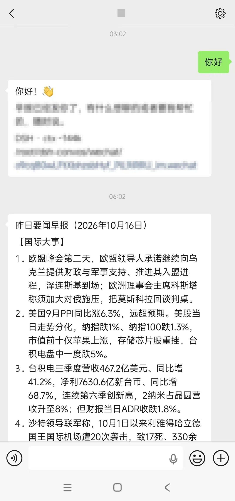
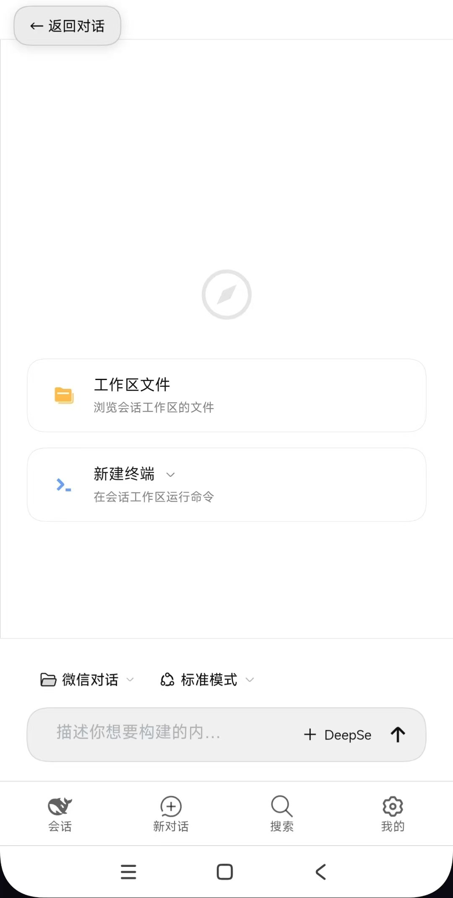

# dsh-phone-bridge

**Turn [DeepSeek Harness](https://github.com/deepseek-ai/deepseek-harness) (DSH) into something you can carry in your pocket** — a WeChat bot that talks to your DSH from anywhere, plus a plugin that reshapes the DSH web UI into a phone-shaped app.

[中文说明](README.zh-CN.md) · [Setup guide](docs/SETUP.md) · [Pitfalls](docs/PITFALLS.md) · [**Usage boundary**](docs/USAGE-BOUNDARY.md)

> ⚠️ **Personal use only.** This is a single-owner tool: one person, one bot, one conversation. It is **not** authorised for public services, group messaging, marketing, harassment, privacy invasion, circumventing platform rules, or operating someone else's account — see [docs/USAGE-BOUNDARY.md](docs/USAGE-BOUNDARY.md). You are solely responsible for how you deploy it.

<p align="center">
  
  &nbsp;&nbsp;
  
</p>

## What's inside

Two independent DSH plugins — use either one on its own.

### 1. `dsh-wechat-connect` — WeChat bridge

Runs on your server and long-polls the WeChat iLink bot gateway. Text, images, voice and files go both ways, in **one single conversation** with **one single working directory** — the bot serves its owner and nobody else.

- **Send the bot a photo** → DSH reads it with vision tools. **Send a document** → DSH opens it.
- **Ask for a file** → the model writes `[[send:/abs/path]]` and the bridge uploads it back to the chat.
- **Scheduled digest** — at a configured time every day, DSH researches the previous day's world + AI news and pushes it as **both** a chat message and a Word document.
- **Self-healing** — the long-poll loop rebuilds itself after any failure, and writes a heartbeat so an external watchdog can catch the "process alive but wedged" case.

### 2. `dsh-mobile-ui` — phone layout for the DSH web UI

The shipped web surface is a three-column desktop layout; on a phone the composer hides behind the keyboard, the sidebar crushes the conversation to a sliver, and the settings page wraps every label one character per line. This plugin injects a stylesheet plus a small script through the documented `webserver/index-inject` seam — **no source edits, no dist patching**:

| Problem on a phone | What the plugin does |
|---|---|
| Left icon rail eats 56px, controls are 28px tall | Bottom tab bar, 44px touch targets |
| Keyboard covers the composer | Layout height tracks `visualViewport` |
| Sidebar squeezes content to 132px | Full-screen conversation drawer that auto-closes on pick |
| Settings crushes labels vertically | Full-screen single column, nav becomes a horizontal strip |
| Right sidebar opens with no way back | A visible "← back to chat" button |
| iOS zooms the page on focus | 16px inputs |

## Repository layout

```
packages/
  dsh-wechat-connect/   WeChat bridge plugin (iLink gateway)
  dsh-mobile-ui/        Phone layout plugin (HTTP injection, no source edits)
deploy/
  systemd/              boot start, crash restart, watchdog, session filing, journald caps
  scripts/              watchdog + workspace-filing scripts
  nginx/                reverse proxy + mTLS device-level access example
docs/
  SETUP.md              zero-to-running deployment guide
  PITFALLS.md           18 hard-won lessons about DSH internals and the WeChat gateway
```

## Quick start

```bash
# Server with Node 20+
npm i -g @deepseek-ai/dsh

# Drop the plugins into a DSH profile and list them in its bundles — see docs/SETUP.md
```

Minimal profile config (`$DSH_HOME/profiles/wechat/cordis.patch.yml`):

```yaml
- id: wechat-connect
  config:
    enabled: true
    sessionProfile: headless
    workDir: /root/dsh-convos/wechat        # one working directory, one session
    allowFrom: "wxid_your_peer@im.wechat"   # your own id only; empty or "*" = anyone
    schedule:
      enabled: true
      time: "06:00"
      prompt: |
        [scheduled digest] Research yesterday's world + AI news, write a Word
        document, summarise it as a chat message, then output [[send:/abs/path]].
```

Full walkthrough — model API, QR login, reverse proxy with client certificates, keep-alive stack: **[docs/SETUP.md](docs/SETUP.md)**.

## Design notes

- **Single owner, single conversation.** The bridge keeps one working directory and one DSH session — the shape the WeChat bot gateway is actually built around. No per-contact machinery to misconfigure.
- **No DSH forks or patches.** The phone layout rides the documented index-injection seam; the bridge is a plain DSH plugin.
- **Clone, don't move.** When the plugin needs a button in a React-owned subtree (bottom tabs, composer actions), it clones the original node and forwards clicks — React reconciliation is never disturbed.
- **Three layers of keep-alive.** systemd restart on crash → in-plugin loop rebuild on failure → external heartbeat watchdog for the wedged-but-alive case.

## Known limits

- The bot is a **separate WeChat account**, not you: it only sees messages sent *to it*, and cannot read your personal chats.
- It is built for one owner. Keep `allowFrom` set to your own WeChat id so strangers who find the bot get ignored.
- Proactive pushes (the digest) need a `context_token` from an inbound message, so you must message the bot once first.
- The iLink bot gateway is not a public, versioned API; `channel_version` changes the upload response shape (the code handles both).

## License and usage boundary

MIT for the code. Usage is limited to **personal self-hosted use** — see [docs/USAGE-BOUNDARY.md](docs/USAGE-BOUNDARY.md).
